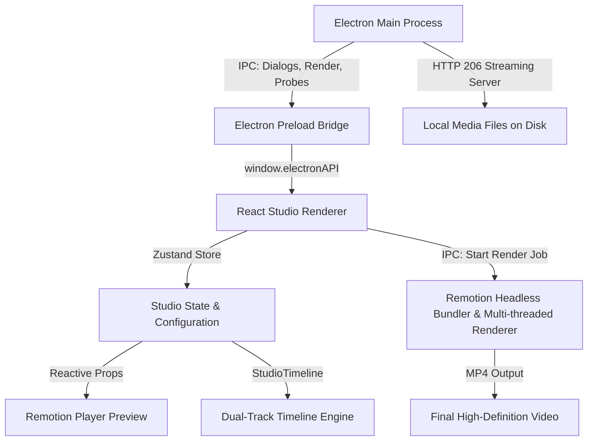

# Quran Video Studio — Architecture & Technical Reference

This document provides a comprehensive technical overview of **Quran Video Studio** for developers and AI agents working on this codebase.

---

## 1. System Overview

Quran Video Studio is a hybrid **Electron + React + Remotion** desktop application. It integrates:
* **Electron (v33)**: Node.js main process, native window orchestration, local SQLite database access, local media streaming server, and child process management for rendering.
* **Vite (v5) + React (v18)**: Interactive studio UI, reactive timeline, parameter inspector, tab navigation, and live canvas player.
* **Remotion (v4)**: Deterministic video compositing engine used both for 60fps interactive playback (`@remotion/player`) and headless parallel MP4 rendering (`@remotion/renderer`).
* **Zustand (v4)**: Centralized state management for template configuration, clip layouts, ayahs, playback progress, and font overrides.



---

## 2. Directory Structure & Key Files

| Directory / File | Description |
| :--- | :--- |
| `src/main/index.ts` | Electron main process entrypoint. Initializes the BrowserWindow, IPC handlers, native menus, and starts the internal HTTP streaming server. |
| `src/main/ipc-handlers.ts` | IPC handlers for open file dialogs, saving video exports, probing video duration, and spawning render jobs. |
| `src/main/services/` | SQLite database query services for Quranic scripts, translation decompression, and audio segment metadata. |
| `src/preload/index.ts` | Context-isolated preload bridge exposing `window.electronAPI`. |
| `src/renderer/App.tsx` | Main studio workspace containing the header toolbar, left parameter tabs, central preview player, and bottom timeline. |
| `src/renderer/store/studio-store.ts` | Single source of truth (Zustand) managing `config`, `ayahs`, `currentFrame`, `isPlaying`, clip actions, and font overrides. |
| `src/renderer/components/timeline/StudioTimeline.tsx` | Interactive dual-track timeline: time ruler scrubber, needle bar, draggable clip boundary dividers, Track A verse inspector, and Track B multi-media sequencer. |
| `src/renderer/components/tabs/` | Parameter editors: `ScriptureTab`, `SubtitlesTab`, `VisualsTab`, `AudioTab`, `BrandingTab`. |
| `src/remotion/Root.tsx` | Remotion root composition registration with dynamic duration and metadata computation. |
| `src/remotion/compositions/TypographyLayer.tsx` | Renders the Surah calligraphy badge, Arabic Quran script, and translations with full alignment, layout order, container toggle, and per-ayah overrides. |
| `src/remotion/compositions/BackgroundLayer.tsx` | Renders multi-clip background sequences with automatic non-repeating video slow-down, Ken Burns effects, in-point trims, overlays, and per-clip transitions. |
| `src/remotion/compositions/WaveformLayer.tsx` | Audio-reactive visualizer waveform. |
| `src/remotion/compositions/BrandingLayer.tsx` | Channel watermark, handles, and logo animation. |
| `src/shared/types.ts` | Shared TypeScript data contracts (`VideoTemplateConfig`, `BackgroundClip`, `AyahFontOverride`, `ScriptBlockType`, `VerticalAlignmentType`). |
| `src/shared/constants.ts` | Default template settings (`DEFAULT_TEMPLATE_CONFIG`), font registries, and background preset list. |
| `src/shared/media-url.ts` | Protocol converter transforming local absolute paths to streaming server URLs (`http://127.0.0.1:<port>/local/...`). |

---

## 3. Core Feature Implementations & Architecture

### A. Typography & Alignment Engine (`TypographyLayer.tsx`)

#### 1. Per-Ayah Custom Font Sizing
* **Problem**: A fixed font size causes long verses (e.g. Surah Al-Baqarah 255) to overflow off-screen or push translation cards beyond the canvas boundary, while short verses appear too small.
* **Implementation**:
  * `config.ayahFontOverrides` is a dictionary keyed by `${surah}:${ayah}`.
  * Overrides allow specifying `arabicFontSize`, `primaryFontSize`, `secondaryFontSize`, and `verticalOffset`.
  * Fallback pattern in `TypographyLayer.tsx`:
    ```typescript
    const ayahKey = `${ayahData.surah}:${ayahData.ayah}`;
    const override = config.ayahFontOverrides?.[ayahKey];
    const arabicFontSize = override?.arabicFontSize ?? config.arabicFontSize;
    const primaryFontSize = override?.primaryFontSize ?? config.primaryFontSize;
    const secondaryFontSize = override?.secondaryFontSize ?? config.secondaryFontSize;
    ```

#### 2. Horizontal & Vertical Alignments
* **Horizontal Alignment (`config.textAlignment`)**:
  * Values: `'center' | 'left' | 'right'`.
  * Applied consistently to `arabicBlock`, `primarySubtitle`, and `secondarySubtitle`.
* **Vertical Alignment (`config.verticalAlignment`)**:
  * Values: `'middle' | 'bottom' | 'top' | 'split'`.
  * **`middle` (Default)**: Centers Quran script and translations together in the vertical middle of the screen (`justifyContent: 'center'`, `gap: 28px`).
  * **`bottom`**: Aligns both to the lower third (`justifyContent: 'flex-end'`, `paddingBottom: '56px'`).
  * **`top`**: Aligns both near the top below the header (`justifyContent: 'flex-start'`, `paddingTop: '130px'`).
  * **`split`**: Keeps Arabic in the center (`margin: 'auto 0'`) while translations are pinned to the bottom.
* **Vertical Fine-Tune Offset (`config.verticalCustomOffset`)**:
  * Micro-adjustment offset from `-150px` to `+150px` applied via `transform: translateY(${verticalOffset}px)`.

#### 3. Layer Ordering (`config.scriptLayoutOrder`)
* Array of `ScriptBlockType[]` defining vertical stack sequence (e.g. `['arabic', 'secondary', 'primary']` puts Quran first, then English, then native subtitles).
* Dynamically reorders JSX nodes in `TypographyLayer.tsx`.

#### 4. Subtitle Container Box Toggle (`config.showTranslationContainer`)
* When `false`, removes background card (`backgroundColor: 'transparent'`, `backdropFilter: 'none'`, `border: 'none'`).
* Applies high-contrast drop-shadows (`textShadow: '0 2px 10px rgba(0,0,0,0.95), 0 0 16px rgba(0,0,0,0.8)'`) so text floats legibly over videos.

---

### B. Non-Repeating Multi-Media Background System (`BackgroundLayer.tsx` & `StudioTimeline.tsx`)

#### 1. Proportional Time Splitting
* Background clips have `percentage` (0–100%) and `durationRatio` (0.0–1.0).
* Adding new clips recalculates equal splits (e.g., 2 clips = 50%/50%, 3 clips = 33.3%/33.3%/33.3%).
* Dragging dividers on the timeline updates left and right clip percentages synchronously while maintaining a 100% total sum.

#### 2. Automatic Video Stretch & Slow-Down (`autoFitSpeed`)
* **Problem**: In traditional video editors, if a background video is 5 seconds long and the recitation is 15 seconds, the video loops 3 times, creating repetitive visual distraction.
* **Solution**:
  * During playback and render, if `clip.autoFitSpeed !== false`, the engine computes:
    $$\text{fitSpeed} = \max\left(0.05, \min\left(1.0, \frac{\text{availableSourceDuration}}{\text{slotDuration}}\right)\right)$$
  * The video plays at `fitSpeed` so it stretches gracefully from start to finish without looping.
  * If the video is longer than the slot, it plays at `1.0×` natural speed without repeating.

#### 3. Per-Cut Transitions
* Each clip specifies its incoming `transition`:
  * `'zoom-fade'` | `'crossfade'` | `'blur-fade'` | `'slide-left'` | `'dip-black'` | `'cut'`.
* In `StudioTimeline.tsx`, each clip transition can be cycled or selected independently via the clip transition pill.

---

### C. Local Media Streaming Server (`src/main/index.ts`)

* **Problem**: Loading local absolute file paths (e.g. `/home/user/video.mp4` or `app-media://...`) in Chromium video tags leads to `net::ERR_UNKNOWN_URL_SCHEME` or format errors because Chromium requires HTTP 206 Partial Content support (`Range` header) for video scrubbing and metadata parsing.
* **Solution**:
  * The Electron main process spawns a lightweight local HTTP server listening on `127.0.0.1:<random_port>`.
  * `src/shared/media-url.ts` converts any local path to `http://127.0.0.1:<port>/local<absolute_path>`.
  * The HTTP server streams video chunks with exact `Content-Range`, `Content-Length`, and `Accept-Ranges: bytes` headers.

---

## 4. State Management Contract (`src/renderer/store/studio-store.ts`)

Key actions in the Zustand store:
* `updateConfig(partial: Partial<VideoTemplateConfig>)`: Merges template configuration changes and persists updates.
* `updateAyahFontOverride(surah, ayah, overrides)`: Sets per-verse font sizes or vertical offsets in `config.ayahFontOverrides`.
* `resetAyahFontOverride(surah, ayah)`: Deletes custom overrides for a verse to restore global template sizes.
* `addBackgroundClip(clip)`: Appends a video/image clip and recalculates normalized percentages.
* `removeBackgroundClip(id)`: Removes a clip and redistributes remaining percentages.
* `updateClipPercentage(id, percentage)`: Adjusts single clip percentage and rebalances neighboring clips.
* `reorderBackgroundClips(fromIndex, toIndex)`: Shifts clip order in the sequence.

---

## 5. Development & Packaging Workflow

1. **Development**:
   ```bash
   npm run dev
   ```
2. **Type-Checking & Vite Build**:
   ```bash
   npm run build:vite
   ```
3. **Pre-Bundling Remotion Composition**:
   ```bash
   npm run bundle:remotion
   ```
4. **Full Production Packaging**:
   ```bash
   npm run pack
   # Produces binary in ./release/linux-unpacked/quran-video-studio
   ```
